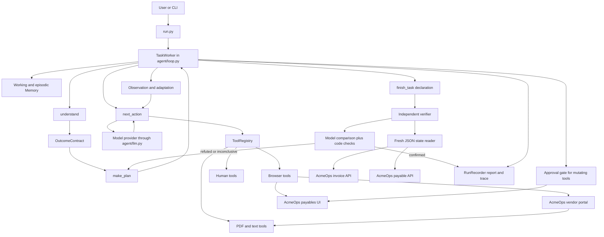

# CentrAlign Autonomous AI Task Worker

An autonomous task worker for a simulated accounts payable environment.

The worker accepts a natural language request, turns it into an explicit
outcome contract, plans a route, operates web applications through a browser,
asks for approval before writes, records evidence, and independently checks
the resulting application state.

This is a focused prototype for the CentrAlign AI Engineering Intern
assessment. It is designed to make the control loop and its safety boundaries
easy to inspect. It is not a production accounts payable system.

## Problem and design objective

The central problem is that an agent's statement that a task is complete is
not proof that the task is complete.

This project separates action from verification:

1. The model chooses tools from the current observation.
2. The controller validates and executes those tools.
3. The application state is read again through independent JSON endpoints.
4. The verifier compares that state with the outcome contract.
5. A failed or inconclusive check causes re planning or an explicit failure.

The implementation is intentionally narrow. AcmeOps is a fictional company
environment with a vendor invoice portal and an internal payables system.

## Key engineering features

* An outcome contract is created before execution. It includes the goal,
  success criteria, required evidence, systems of record, unknowns, and scope.
* The plan is advisory. The model chooses one tool call per turn from live
  observations instead of following a fixed production script.
* The controller owns budgets, retry rules, approval, stuck detection, and
  verification decisions.
* Browser observations are semantic summaries of headings, tables, links, and
  form fields. The model does not receive raw HTML or invent CSS selectors.
* PDF extraction is available as a tool because the invoice PDF contains the
  authoritative tax inclusive total in this environment.
* Mutating tools are marked in the tool registry and pass through the
  controller's approval gate.
* Working memory stores facts with their source and step. Episodic memory
  stores action results and compacts older history.
* Each run writes a report, machine readable trace, screenshots, and downloaded
  documents.
* Verification uses fresh application state rather than the browser's last
  visible message or the worker's narration.

## Quick start

### Requirements

Use Python with the dependencies in [requirements.txt](requirements.txt).
Playwright also needs its Chromium browser installed.

```bash
git clone https://github.com/chavaliadi/CentrAlign.git
cd CentrAlign
python -m venv .venv
source .venv/bin/activate
pip install -r requirements.txt
playwright install chromium
```

The commands above assume macOS or Linux. On Windows, activate the virtual
environment with the command for your shell.

### Configure a model provider

The CLI needs one provider credential for a real model run. Do not place
credentials in the repository. Export an environment variable, or source a
local `.env` file from your shell. The application does not load `.env`
automatically, and the file remains ignored by Git.

The provider is inferred in this order when `AGENT_PROVIDER` is not set:
Anthropic, Groq, then OpenAI.

```bash
export GROQ_API_KEY=your_groq_api_key
```

You can choose a provider explicitly:

```bash
export AGENT_PROVIDER=groq
export AGENT_MODEL=your_model_id
```

Supported provider values are `anthropic`, `groq`, `openai`, and `local`.
`AGENT_VERIFIER_MODEL` can select a separate verifier model. If it is not set,
the verifier uses `AGENT_MODEL`.

The default Anthropic and OpenAI model names are defined in
[agent/config.py](agent/config.py). Groq and local providers resolve a
preferred chat model from the provider's model list when `AGENT_MODEL` is
empty. Use `--list-models` to inspect the available models.

### Run the worker

Run all task definitions with automatic approval and a local AcmeOps process:

```bash
python run.py --all --auto-approve --start-env
```

Run one task with interactive approval:

```bash
python run.py --task invoice_entry --start-env
```

Useful options:

```text
--all                         Run every JSON task in tasks/
--task NAME                   Run one task by id or JSON path
--start-env                   Start AcmeOps as a child process
--auto-approve                Approve writes automatically, still recording them
--review-contract             Ask for approval of the contract before actions
--headed                      Show the Chromium window
--chaos on|off                Enable or disable environment failure injection
--chaos-seed NUMBER           Select the deterministic failure seed
--max-steps NUMBER            Override the action budget
--no-reset                    Keep the current AcmeOps state
--provider NAME               Select the model provider
--model NAME                 Select the model
--list-models                 List models for the selected provider
```

The default application URL is `http://127.0.0.1:8099`. Set
`COMPANY_BASE_URL` to use another URL. The relevant environment variables are
documented in [.env.example](.env.example).

Each run creates a directory under `runs/` containing `report.md`,
`trace.json`, `screenshots/`, and `downloads/`. The CLI also prints the report
path and returns a nonzero exit code when a task does not complete.

## Demo tasks

The task JSON files contain the request, environment notes, human answers for
scripted approval mode, and the environment profile used when resetting
AcmeOps. They do not contain a fixed action sequence.

| Task | Purpose |
| --- | --- |
| [`invoice_entry`](tasks/invoice_entry.json) | Find the latest Northwind Traders invoice, read its authoritative PDF amount and due date, then create a payable. |
| [`outstanding_report`](tasks/outstanding_report.json) | Calculate the unpaid total for Globex Corporation. This is read only and does not request write approval. |
| [`correct_due_date`](tasks/correct_due_date.json) | Compare Northwind payable data with the vendor portal and correct an incorrect due date in place. |

The same `TaskWorker`, planner, tool registry, and browser toolset are used
for all three tasks. The task profile changes the seeded AcmeOps state so each
task is evaluated against an appropriate starting condition.

## AcmeOps environment

[acmeops/](acmeops/) is a FastAPI and SQLite application with real HTTP
requests, HTML pages, sessions, persisted writes, and generated PDFs.

* `/portal` is the authenticated vendor invoice portal. It lists invoices,
  supports vendor and status filters, shows invoice details, and serves PDFs.
* `/payables` is the internal payables application. It displays records and
  provides create and edit forms.
* `/api/payables` and `/api/invoices` are read only JSON endpoints used by the
  verifier's state reader.
* `/admin/reset` rebuilds the seeded world for a task profile. It is a local
  test harness endpoint, not a worker capability.

The portal list deliberately shows the pre tax subtotal. The invoice PDF shows
the total payable, including tax. For example, seeded invoice `INV-1067` has
a subtotal of `6843.00` and a total payable of `7390.40`. The task notes state
which value accounts payable must record.

### Failure injection

`acmeops/chaos.py` provides a seeded failure environment when
`ACMEOPS_CHAOS=on`:

* intermittent HTTP 503 responses on reads,
* one portal session expiry during a run,
* two HTML layout variants with reordered columns and changed labels,
* occasional delayed responses.

The seed is controlled by `ACMEOPS_CHAOS_SEED`. `--chaos off` is useful for
exact tool tests and clean diagnosis. Chaos makes a real model run exercise
recovery, but a fixed scripted test cannot recover from every injected event,
so the scripted end to end suite runs with chaos disabled.

## Architecture



### Component boundaries

| Component | Responsibility | Boundary |
| --- | --- | --- |
| [`run.py`](run.py) | Loads task JSON, starts AcmeOps when requested, resets the task profile, builds the worker, and prints results. | It wires the environment and toolset but does not choose actions. |
| [`TaskWorker`](agent/loop.py) | Owns the lifecycle, action budget, retries, approval, memory updates, stuck detection, verification, and final status. | It depends on `Observation`, `ToolRegistry`, and an injected toolset factory, not browser or invoice classes. |
| [`planner.py`](agent/planner.py) | Converts the request into an `OutcomeContract`, creates an advisory plan, and selects the next tool call. | Model output is advice or a tool choice. The controller still validates and executes it. |
| [`llm.py`](agent/llm.py) | Normalizes Anthropic and OpenAI compatible provider calls, tool schemas, JSON parsing, and known request repairs. | Provider specific wire formats stop here. |
| [`tools/base.py`](agent/tools/base.py) | Defines `Observation`, `Tool`, and `ToolRegistry`. | Tools expose typed schemas and whether they mutate state. |
| [`toolsets.py`](agent/toolsets.py) | Injects the default browser, file, and human toolset. | A different toolset can be supplied without changing the controller. |
| [`tools/browser.py`](agent/tools/browser.py) | Drives Chromium with Playwright and converts rendered pages into semantic digests. | It hides DOM details from the model and returns observations. |
| [`tools/files.py`](agent/tools/files.py) | Extracts text from downloaded PDFs and text files. | It does not decide which value is correct. |
| [`tools/human.py`](agent/tools/human.py) | Provides `ask_human`, `remember`, and `finish_task`. | Human questions are model chosen; write approval is controller enforced. |
| [`memory.py`](agent/memory.py) | Stores provenance backed facts and action episodes for the current run. | It is discarded when the run ends. |
| [`verifier.py`](agent/verifier.py) | Reads fresh state, asks a verifier model to compare it with the contract, and applies structural and invoice checks. | It does not use the browser transcript as proof. |
| [`evidence.py`](agent/evidence.py) | Writes `report.md`, `trace.json`, screenshots, and downloads. | It records what happened; it is not the source of truth for application state. |

## Agent lifecycle

### 1. Intake and contract creation

`run.py` loads the task request and environment notes. `planner.understand()`
asks the model to produce an `OutcomeContract`. The contract describes what
must be true after the task, which evidence matters, whether a write is
required, and which systems hold the relevant truth.

If `--review-contract` is enabled, the controller asks the human to approve
this contract before any tool runs. Declining it returns a blocked result.

### 2. Planning

`planner.make_plan()` receives the contract, tool descriptions, and environment
notes. It returns intended steps and risks. The plan is recorded for evidence,
but it is not a script and the controller does not execute its steps directly.

### 3. Observe, choose, and execute

On every turn, `planner.next_action()` receives:

* the outcome contract,
* the advisory plan,
* environment notes,
* established facts,
* recent action history,
* available tool schemas,
* the current step and remaining budget,
* any controller intervention note.

The model must choose exactly one registered tool. A model response without a
tool call consumes a step and is retried up to the controller's no action
failure limit.

The controller looks up the tool, executes it, and receives an `Observation`.
An observation contains a success flag, summary, structured data, an error,
retryability, facts for memory, and artifact paths. Only the summary and
controller supplied context are sent to the model as its working view.

### 4. Approval and memory

Every tool marked `mutating=True` passes through `_seek_approval()` before it
runs. Interactive mode asks for `y` or `N`. Automatic approval still records
the decision in the trace. A denied write is not retried.

`ask_human` is different. It is a model chosen question for an ambiguity or
missing fact. It is not a substitute for the approval gate.

Successful observations can add facts to working memory. The `remember` tool
lets the model record a fact such as an invoice total with a URL or file path
and a note. Episodic memory records every action and observation. Older
episodes are compacted before being sent back to the model.

### 5. Failure handling and adaptation

Tools mark transient failures with `retryable=True`. Non mutating actions can
be retried up to `max_action_retries`, with increasing backoff. Mutating
actions are never retried by the controller, even if a tool claims they are
transient. A write may have committed before its response was lost, so the
worker must inspect state before attempting another write.

The controller also detects:

* three consecutive failed actions,
* three identical action and argument pairs,
* repeated successful observations that reveal no new information,
* repeated model responses with no tool call.

It sends a corrective note to the model or ends the run when the relevant
limit is reached. The default action budget is 28 steps and the default
verification re plan budget is two revisions. These values can be changed
through the settings in [agent/config.py](agent/config.py) or the CLI step
option.

The browser session persists across turns. If AcmeOps redirects to its login
page after session expiry, the model can authenticate again using the task
notes. The semantic digest uses field names, visible link text, table keys, and
labels rather than positions, so the two seeded layouts can be handled by the
same tools.

### 6. Completion and verification

`finish_task` produces a terminal observation, but it does not end the run.
The controller calls `verify()` with the contract, the declaration, and a
fresh `read_state` function.

If verification confirms the contract, the controller reports `completed`, or
`blocked` if the worker deliberately reported a blocked outcome. If it returns
`refuted` or `inconclusive`, the controller records the reason, creates a new
plan, and gives the model a correction note. When the re plan budget is
exhausted, the final status is `failed_verification` or `blocked`.

Other terminal statuses include `budget_exhausted` and `error`. Every terminal
path is written to the evidence folder.

## Verification and evidence

Verification has several layers.

### Application state

The CLI supplies a state reader that calls `/api/payables` and
`/api/invoices`. These endpoints read the SQLite backed application state
directly. The worker's browser observations and narration are not used as a
replacement for this read.

### Model comparison

The verifier model receives only:

* the outcome contract,
* the worker's declared result,
* the freshly read application state.

It does not receive the action transcript, model reasoning, or browser
success messages. It must return a structured verdict, criterion findings,
discrepancies, a reason, and a proposed correction.

The controller rejects malformed confirmations, confirmations with no
criteria, confirmations with unmet criteria, confirmations that omit contract
criteria, and confirmations based on truncated state.

### Deterministic invoice checks

For write contracts that mention an invoice or payable, the current verifier
also applies code checks to the existing state. It requires a uniquely
identified invoice and exactly one matching payable. Where the contract and
state support the comparison, it checks vendor, amount, and due date. Amounts
are compared with `Decimal` values and dates are compared as exact stored
strings. Missing, duplicate, or ambiguous records do not become success.

This is stronger than trusting a browser success message, but it is not a
complete proof of correctness. A model can write an incomplete outcome
contract. If the contract omits a requirement, the verifier cannot reliably
check that omitted requirement. The contract remains a model generated input
and is therefore a significant limitation.

### Evidence outputs

`RunRecorder` writes:

* `report.md`, a human readable summary with the contract, result, verification
  table, approvals, screenshots, downloads, and step log;
* `trace.json`, the machine readable settings, events, contract, memory, and
  final result;
* `screenshots/`, when the worker captures important browser states;
* `downloads/`, including retrieved invoice PDFs.

Evidence supports review and debugging. It does not replace the independent
state read.

## Reliability and safety boundaries

The following guarantees are implemented in code:

* writes are identified by the registry's `mutating` flag;
* writes require approval and denied writes are not retried;
* transient read retries are limited and use backoff;
* mutating actions are not automatically retried;
* repeated failures and repeated no progress cause controller intervention;
* action and re plan budgets prevent unbounded loops;
* verification failure causes re planning or a reported failure;
* session recovery and layout adaptation are possible through browser
  observations and the task notes;
* duplicate write attempts are surfaced to the model and can fail
  verification.

These are safety boundaries, not guarantees that every task succeeds. A write
can commit while its response is lost. The controller avoids blindly
repeating that write, but the final result may still be inconclusive.

## Testing and evaluation

The repository uses executable Python test modules rather than pytest test
discovery. The following commands are the documented test entry points.

### Offline suites

These do not need an API key:

```bash
python -m tests.test_loop_offline
python -m tests.test_llm_provider
python -m tests.test_paraphrase_offline
python -m tests.test_verifier
```

They cover controller recovery, approvals, budgets, provider normalization,
JSON repair, outcome contract shape across request wording, and deterministic
invoice verification with the verifier model stubbed.

The latest focused verifier run observed 8 passed and 0 failed. The provider
suite observed 36 passed and 0 failed. The paraphrase suite observed 23 passed
and 0 failed. The controller suite completed successfully.

### Live AcmeOps tool tests

Start AcmeOps with failure injection disabled:

```bash
ACMEOPS_CHAOS=off python -m uvicorn acmeops.app:app --port 8099
```

In another terminal:

```bash
python -m tests.test_tools
```

This suite uses Chromium and checks login, semantic page digests, both layout
variants, PDF extraction, the subtotal versus total payable distinction, and a
write through the UI. It does not need a model API key.

The observed run in this workspace reported 33 passed and one pre existing
failure in its record count assertion. That failure is in the existing live
tool test setup, not in the README change. The suite should be rerun in a
fresh environment when diagnosing it.

### Scripted end to end test

```bash
python -m tests.test_end_to_end_scripted
```

This uses a real Chromium, real login, real PDF download, real form
submission, real approval plumbing, and real application state reads. It
replaces the model's action selection and verifier with deterministic test
functions. The observed run reported 18 passed and 0 failed.

Therefore it proves the controller and environment plumbing, not the quality
of a live model's decisions.

### Real model runs

```bash
python run.py --all --auto-approve --start-env
```

This exercises the actual provider, planner, action selection, and verifier
model calls. Results depend on the selected model, provider limits, credentials,
chaos seed, and available step budget. The repository does not claim that a
scripted run measures live model reasoning.

## Representative execution

The tracked example at
[runs/examples/invoice_entry-confirmed/report.md](runs/examples/invoice_entry-confirmed/report.md)
shows a successful invoice entry run.

The task asked the worker to enter the latest Northwind Traders invoice. The
trace records these meaningful steps:

1. The worker signed into the vendor portal and identified `INV-1067` as the
   latest seeded Northwind invoice by issued date.
2. The portal page showed a pre tax subtotal of `6843.00` and indicated that
   the total payable was in the PDF.
3. The worker downloaded and read the PDF, which contained a total payable of
   `7390.40` and due date `2026-10-28`.
4. It opened the payables form and submitted the record through the approval
   boundary.
5. The environment injected two recoverable read retries before the form
   loaded.
6. The final report recorded a confirmed verification and two automatic
   approval decisions.

This artifact is a demonstration record, not a claim that every model run
will follow the same sequence or succeed at the same step count.

## Current limitations

* The outcome contract is model generated. An omitted requirement can escape
  verification.
* Verification still includes a model comparison, so it is not fully
  deterministic.
* The deterministic invoice checks cover the existing AcmeOps data shape and
  write contracts. They are not a general enterprise reconciliation engine.
* Working and episodic memory are discarded after each run. There is no
  persistent company memory.
* There is no concurrency or scheduling layer. The CLI runs tasks one at a
  time.
* The semantic browser digest targets tables, definition lists, labelled
  fields, and links. Canvas based or heavily client side applications would
  need additional adapters.
* The environment and its seeded data were written for this assessment. The
  agent has no hidden AcmeOps API knowledge, but AcmeOps is not an external
  production application.
* The repository does not contain a statistical evaluation across many chaos
  seeds and providers.

## Future improvements

These are not implemented:

1. Let a human review and amend the outcome contract before execution.
2. Add persistent company memory with controlled provenance and retention.
3. Build an evaluation harness across providers, models, and chaos seeds.
4. Extend deterministic checks as more application schemas are supported.
5. Evaluate against a second environment created independently of the worker.
6. Add scheduling and concurrency controls with explicit write coordination.

## Technology stack and coding tool disclosure

* Python
* FastAPI, Uvicorn, Jinja2, and SQLite for AcmeOps
* Playwright and Chromium for browser automation
* ReportLab for generated invoice PDFs
* pypdf for PDF text extraction
* Anthropic and OpenAI compatible provider SDKs

There is no LangChain, LlamaIndex, CrewAI, or other agent framework in the
control path. The controller and tool interfaces are implemented in this
repository.

The repository was developed with AI coding assistance. The implementation,
tests, task definitions, and documentation remain subject to human review.
Scripted tests replace model decisions where stated; they do not demonstrate
that a live model performed the same reasoning.

## Assumptions and trade offs

* “Latest invoice” means the most recently issued invoice in the seeded data,
  not the nearest due date.
* The invoice PDF is authoritative for the total payable because the task
  policy says the payable amount is tax inclusive.
* One approval boundary per mutating tool call is appropriate for this
  sandbox. Automatic approval is available for reproducible unattended runs,
  but the decision remains in the trace.
* The verifier's state reader uses local JSON endpoints because this is a
  self contained environment. A deployment against external systems would
  need an equivalent trusted state interface.
* The browser is the interaction surface, so the worker does not assume
  private application APIs for its actions.
