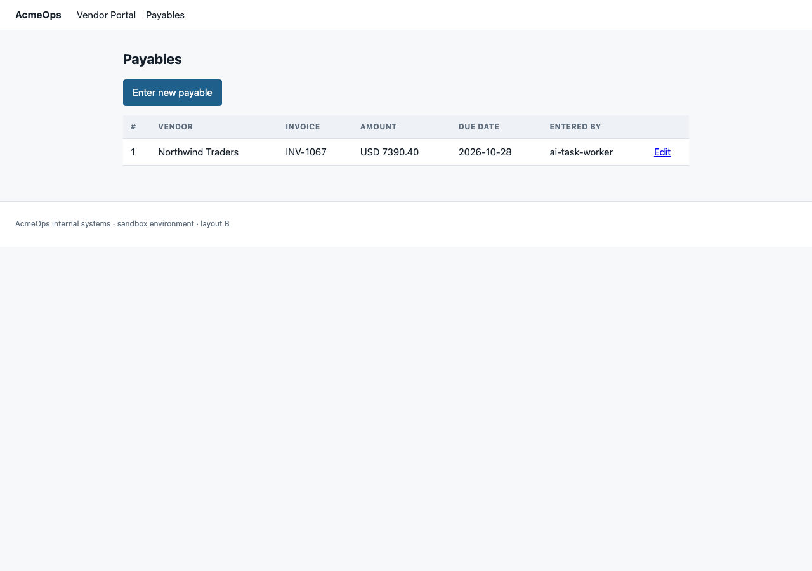

# Run report - invoice_entry

**Task.** Find the latest invoice from Northwind Traders, get the amount and the due date, enter it into our payables system, and tell me once it's done.

- Status: **completed**
- Model: `groq:openai/gpt-oss-20b`
- Steps used: 9 of 30
- Re-plans: 0
- Verification: **confirmed**

## Answer

INV-1067

## What the worker did

Created a new payable record for Northwind Traders invoice INV-1067 with amount USD 7,390.40 and due date 2026-10-28, verified by screenshot of the payables list and the invoice PDF.

## Independent verification

All success criteria are satisfied by the current state.

| Criterion | Met | Evidence in system state |
| --- | --- | --- |
| Payable record exists with vendor 'Northwind Traders', invoice number matching latest invoice, amount equal to total payable on invoice PDF | yes | vendor='Northwind Traders', invoice_number='INV-1067', amount=7390.4 |
| Payable record includes due date that matches due date shown on invoice PDF | yes | due_date='2026-10-28' |
| Payable record is visible in payables system's list or detail view | yes | payables list contains record id 1 |

## Approvals requested

- `browser_fill_form` - approved (auto-approved)
- `browser_fill_form` - approved (auto-approved)

## Screenshots

## Documents retrieved

- `downloads/INV-1067.pdf`

## Step log

**1. `browser_open`** - ok
    args: `{"url": "http://127.0.0.1:8099/portal"}`
    Loaded (HTTP 200): Sign in - AcmeOps Vendor Portal <http://127.0.0.1:8099/portal/login?reason=required>
NOTICES: Please sign in to view the vendor portal.
HEADINGS: Vendor Portal sign in
FORM #login-form POST /portal/login
  name='email' label='Email address' type=email required
  name='password' label='Password' type=password required
  submit button labels: ['Sign in']
LINKS: 'AcmeOps' -> /; 'Ve

**2. `browser_fill_form`** - ok
    args: `{"submit": true, "submit_label": "Sign in", "values": {"email": "ap.clerk@acme.example", "password": "Vendor#2026"}}`
    Filled email=ap.clerk@acme.example, password=Vendor#2026 and submitted. Result page: Vendor Invoices - AcmeOps <http://127.0.0.1:8099/portal>
HEADINGS: Vendor invoices
TABLE #invoice-table (7 row(s))
  columns: INVOICE | VENDOR | SUBTOTAL (NET) | ISSUED | DUE DATE | STATUS | 
  [INV-1031] INV-1031 | Northwind Traders | USD 4462.96 | 2026-08-14 | 2026-09-13 | paid | View details   (link 'View detai

**3. `browser_click`** - ok
    args: `{"nth": 5, "text": "View details"}`
    Clicked 'View details'. Now at: INV-1067 - AcmeOps <http://127.0.0.1:8099/portal/invoice/INV-1067>
HEADINGS: Invoice INV-1067
TABLE #invoice-detail (6 row(s))
  columns: Vendor
  Vendor | Northwind Traders
  Subtotal (net) | USD 6843.00
  Total payable | See attached PDF
  Issued date | 2026-09-28
  Due date | 2026-10-28
  Status | unpaid
SEMANTIC FIELDS: vendor='Northwind Traders', net_amount='US

**4. `browser_download`** - ok
    args: `{"url": "http://127.0.0.1:8099/portal/invoice/INV-1067/pdf"}`
    Downloaded http://127.0.0.1:8099/portal/invoice/INV-1067/pdf to /Users/srinivasch/Downloads/centralign-task-worker/runs/20261024-055343-invoice_entry/downloads/INV-1067.pdf (2375 bytes).

**5. `read_pdf`** - ok
    args: `{"max_pages": 3, "path": "/Users/srinivasch/Downloads/centralign-task-worker/runs/20261024-055343-invoice_entry/downloads/INV-1067.pdf"}`
    Text of INV-1067.pdf (1 page(s)):
INVOICE
Invoice No: INV-1067
 Issued: 2026-09-28
From
Northwind Traders Pvt. Ltd.
14 Harbour Road, Singapore 099253
Bill to
Acme Corporation
Accounts Payable
1 Acme Plaza, Wilmington, DE 19801
Payment terms
Payment due date: 2026-10-28
Terms: Net 30 from date of issue
Summary
Subtotal (net of tax)
USD 6,843.00
Tax
USD 547.40
TOTAL PAYABLE
USD 7,390.40
This documen

**6. `browser_open`** - ok
    args: `{"url": "http://127.0.0.1:8099/payables/new"}`
    (recovered after 2 retry/retries) Loaded (HTTP 200): New Payable - AcmeOps Internal <http://127.0.0.1:8099/payables/new>
HEADINGS: Enter new payable
FORM #payable-form POST /payables/new
  name='vendor' label='Vendor' type=select options=['Northwind Traders', 'Globex Corporation', 'Initech Supplies'] current='Northwind Traders' required
  name='invoice_number' label='Invoice number' type=input req

**7. `browser_fill_form`** - ok
    args: `{"submit": true, "submit_label": "Submit", "values": {"amount": "7390.40", "due_date": "2026-10-28", "invoice_number": "INV-1067", "vendor": "Northwind Traders"}}`
    Filled amount=7390.40, due_date=2026-10-28, invoice_number=INV-1067, vendor=Northwind Traders and submitted. Result page: Payables - AcmeOps Internal <http://127.0.0.1:8099/payables?created=1>
HEADINGS: Payables
TABLE #payables-table (1 row(s))
  columns: # | VENDOR | INVOICE | AMOUNT | DUE DATE | ENTERED BY | 
  [1] 1 | Northwind Traders | INV-1067 | USD 7390.40 | 2026-10-28 | ai-task-worker | Ed

**8. `browser_screenshot`** - ok
    args: `{"label": "payables_new_record"}`
    Screenshot saved for evidence: /Users/srinivasch/Downloads/centralign-task-worker/runs/20261024-055343-invoice_entry/screenshots/01-payables-new-record.png

**9. `finish_task`** - ok
    args: `{"answer": "INV-1067", "evidence": "Screenshot: /Users/srinivasch/Downloads/centralign-task-worker/runs/20261024-055343-invoice_entry/screenshots/01-payables-new-record.png; PDF: /Users/srinivasch/Downloads/centralign-ta`
    Completion declared; handing over to independent verification.

---

Full machine-readable trace: `trace.json`.